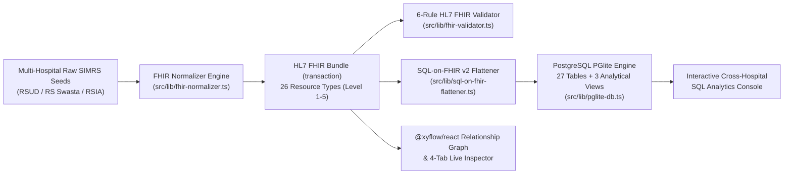

# Technical Architecture Specification (v10.0)
## Global HL7 FHIR, SQL-on-FHIR v2 (`fhir-data-pipes`) & Pioneer Healthcare Normalization Learning Lab

---

## 1. Architectural Vision & Strategic Point of View (POV)

This application is an interactive web learning platform and production-grade healthcare data normalization sandbox that unifies heterogeneous Indonesian hospital information system (SIMRS) schemas into **PostgreSQL (via in-browser WebAssembly PGlite)** using the official **HL7 FHIR Standard** and **SQL-on-FHIR v2 (`fhir-data-pipes`)**.

### Core Paradigm: "Global-First Pioneer Blueprint for Indonesia"
1. **End-to-End Official HL7 FHIR Standard (Levels 1 to 5):**
   Normalizes hospital medical records across Foundation (Level 1), Terminology & Security (Level 2), Administration (Level 3), Clinical/Diagnostics/Medications (Level 4A), Workflow (Level 4B), Financial & Claims (Level 4C), and Clinical Reasoning & Quality Reporting (Level 5).
2. **Pioneer Global Standard for Unregulated National Domains:**
   Where national implementation (SATUSEHAT) only covers baseline administration and clinical resources, this system acts as the **pioneer national blueprint** by implementing the official global HL7 FHIR specification for Financial & Claims (`Coverage`, `CoverageEligibilityResponse`, `Account`, `ChargeItem`, `Claim`, `ClaimResponse`, `ExplanationOfBenefit`), Workflow (`ServiceRequest`, `Appointment`), and Quality Reporting (`MeasureReport`).
3. **Explicit Adoption Status Badges Across Every Module, Resource, and Table:**
   - 🟢 `IMPLEMENTED_SATUSEHAT` — **`[IMPLEMENTED IN INDONESIA - SATUSEHAT BASELINE]`**
   - 🟡 `PARTIAL_NATIONAL` — **`[PARTIAL IN INDONESIA - EXTENDED BY GLOBAL FHIR]`**
   - 🔵 `PIONEER_GLOBAL_FHIR` — **`[PIONEER GLOBAL FHIR STANDARD - READY FOR INDONESIA ADOPTION]`**

---

## 2. Tech Stack & System Architecture

| Layer | Technology | Role |
| :--- | :--- | :--- |
| **Runtime & Bundler** | Bun + Vite + React 18 + TypeScript (`strict: true`) | Fast bundling, strict static typing, modern ESM |
| **Styling & Icons** | Tailwind CSS + `lucide-react` | Responsive 3-panel split-screen workspace UI & status badges |
| **State Management** | `zustand` | Reactive state orchestration across curriculum, sandbox, normalizer, validator, flattener, and PGlite |
| **In-Browser PostgreSQL** | `@electric-sql/pglite` | Real PostgreSQL engine running via WebAssembly in the browser (27 relational tables + 3 analytical views) |
| **Graph Visualization** | `@xyflow/react` | Interactive node-edge graph showing clinical-to-financial FHIR `Reference` chains |

### Architectural Data Flow

---

## 3. Zero-Bug Conformance Invariants

1. **`Claim.total` (`0..1 Money`) vs `ClaimResponse.total[]` & `ExplanationOfBenefit.total[]` (`0..* BackboneElement`):**
   - `Claim.total` is a direct `Money` object (`{ value: number, currency: 'IDR' }`), **never** an array. Its SQL-on-FHIR v2 FHIRPath expression is `total.value` and `total.currency`.
   - `ClaimResponse.total[]` and `ExplanationOfBenefit.total[]` are arrays of `BackboneElement` containing `category` (`http://terminology.hl7.org/CodeSystem/adjudication`: `submitted` vs `benefit`) and `amount` (`Money`).
2. **Separation of `fhir_claim` Header and `fhir_claim_item` Detail (`forEach: "item"`):**
   - `fhir_claim_header_view` populates `fhir_claim` (1 row per claim).
   - `fhir_claim_item_view` uses `forEach: "item"` to unnest `Claim.item[]` into `fhir_claim_item` (N rows per claim, with composite primary key `claim_id + '-' + sequence`).
   - Every `Claim.item[]` element must carry `sequence` (`1..1`), `productOrService` (`1..1` mandatory `CodeableConcept`), `category` (`http://terminology.hl7.org/CodeSystem/ex-benefitcategory`), `encounter` (`Reference(Encounter)[]`), and `net` (`Money` in `IDR`).
3. **Native Browser SQL-on-FHIR v2 Evaluator (`src/lib/sql-on-fhir-flattener.ts`):**
   - Full support for `getResourceKey()`, `getReferenceKey('ResourceType')`, polymorphic `getReferenceKey()` (no argument, returning `'ResourceType/id'` or extracting ID/type for `Provenance.target` and `ChargeItem.supportingInformation`), `.where(...)`, `.first()`, `.exists(...)`, `.ofType(...)`, and `forEach` / `forEachOrNull`.
   - Synchronizes `diagnosis_role_code` (`AD | DD | CC | CM`) and `diagnosis_rank` (`1..n`) from `Encounter.diagnosis[]` into `fhir_condition`.
4. **HL7 FHIR Invariants (`obs-7`, `cmp-1`, `bdl-3`):**
   - **`obs-7` (Observation Multi-Component):** Multi-component panels such as Blood Pressure (`LOINC 85354-9`) store Systolic (`8480-6`) and Diastolic (`8462-4`) in `Observation.component[]` with UCUM `mm[Hg]` and **must omit** root `value[x]` (`valueQuantity`, `valueString`, etc.).
   - **`cmp-1` (Composition Section):** Every `Composition.section[]` entry must contain at least one of `entry[]` (non-empty `Reference[]`), `text` (narrative XHTML), or `emptyReason` (`CodeableConcept`).
   - **`bdl-3` (Bundle Transaction):** Every `Bundle.entry[]` in a `transaction` bundle must carry `fullUrl` (supporting `urn:uuid:`) and `request: { method, url }`, ordered strictly `DELETE -> POST -> PUT -> GET`, with all `urn:uuid:` references resolved to canonical `ResourceType/id` references prior to PostgreSQL persistence.

---

## 4. Modular File Structure & Contract Specifications

### 4.1 Phase 1 & Phase 2 Core Modules (Mandatory Exact Paths)

#### 1. `src/types/fhir-global.ts`
Defines all strict TypeScript contracts:
- `ImplementationStatus`: `'IMPLEMENTED_SATUSEHAT' | 'PARTIAL_NATIONAL' | 'PIONEER_GLOBAL_FHIR'`
- Base HL7 FHIR DataTypes: `Coding`, `CodeableConcept`, `Identifier`, `Reference`, `Quantity`, `SimpleQuantity`, `Money`, `Period`, `Extension`, `Narrative`, `Address`, `HumanName`, `Signature`
- All HL7 FHIR Resource Interfaces (Levels 1–5):
  - Level 1 & 2: `FhirResourceBase`, `Bundle`, `BundleEntry`, `Consent`, `Provenance`
  - Level 3: `Organization`, `Patient`, `Practitioner`, `Location`, `EpisodeOfCare`, `ServiceRequest`, `Encounter`
  - Level 4A & 4B: `Condition`, `Procedure`, `Observation`, `DiagnosticReport`, `Medication`, `MedicationRequest`, `MedicationDispense`, `Composition`, `Appointment`
  - Level 4C (Pioneer Financial & Claims): `Coverage`, `CoverageEligibilityResponse`, `Account`, `ChargeItem`, `Claim`, `ClaimItem`, `ClaimResponse`, `ExplanationOfBenefit`
  - Level 5 (Pioneer Quality): `MeasureReport`
  - Discriminated union `FhirResource` and normalized bundle container `NormalizedHospitalDataset`
- SQL-on-FHIR v2 types: `ViewDefinition`, `ViewDefinitionSelect`, `ViewDefinitionColumn`, `FlattenedTableRows`
- Validator types: `ValidationRuleId` (the 6 official rule IDs), `ValidationIssue`, `ValidationRuleResult`, `ValidationReport`
- Raw SIMRS input schema types (`SimrsHospitalSeed`, `TerminologyDictionary`) and sandbox mutation options (`SandboxClinicalFinancialOverrides`).

#### 2. `src/lib/pglite-db.ts`
Manages the in-browser `@electric-sql/pglite` PostgreSQL database:
- Exports `FHIR_DDL_SQL`: Complete DDL for all **27 tables** (`fhir_organization`, `fhir_patient`, `fhir_practitioner`, `fhir_location`, `fhir_episode_of_care`, `fhir_service_request`, `fhir_encounter`, `fhir_consent`, `fhir_provenance`, `fhir_condition`, `fhir_procedure`, `fhir_observation`, `fhir_diagnostic_report`, `fhir_medication`, `fhir_medication_request`, `fhir_medication_dispense`, `fhir_composition`, `fhir_appointment`, `fhir_coverage`, `fhir_coverage_eligibility_response`, `fhir_account`, `fhir_charge_item`, `fhir_claim`, `fhir_claim_item`, `fhir_claim_response`, `fhir_explanation_of_benefit`, `fhir_measure_report`) with `ON UPDATE CASCADE ON DELETE CASCADE` / `SET NULL` and `raw_fhir JSONB NOT NULL`, plus the **3 Analytical Views** (`vw_fhir_clinical_diagnosis_recap`, `vw_fhir_financial_claim_recap`, `vw_fhir_clinical_to_claim_audit`).
- Exports `TABLE_METADATA`: Metadata for all 27 tables + 3 views (table name, resource type, level, implementation status badge, description).
- Exports database lifecycle & query functions:
  - `initPgliteDatabase(existingInstance?: PGlite): Promise<PGlite>`
  - `syncDatasetToPglite(db: PGlite, datasets: NormalizedHospitalDataset[]): Promise<void>`
  - `executeSqlQuery(db: PGlite, sql: string, params?: unknown[]): Promise<SqlQueryExecutionResult>`
  - `resolveAndMergeDuplicatePatient(db: PGlite, dataset: NormalizedHospitalDataset, duplicatePatientId: string, targetMasterPatientId: string): Promise<{ updatedDataset: NormalizedHospitalDataset; mergedPatient: Patient }>`

#### 3. `src/data/simrs-normalization-seeds.ts`
Provides multi-hospital raw SIMRS datasets, terminology dictionaries, and educational annotations:
- `STANDARD_TERMINOLOGY_DICTIONARY`: ICD-10, ICD-9-CM, LOINC, SNOMED-CT, UCUM, KFA, Wilayah Kemendagri (`province`, `city`, `district`, `village`, `rt`, `rw`), and HL7 Financial CodeSystems (`claim-type`, `ex-benefitcategory`, `ex-diagnosistype`, `adjudication`, `coverage-class`, `discharge-disposition`, `diagnosis-role`).
- `SIMRS_HOSPITAL_SEEDS`: 3 distinct Indonesian hospitals with heterogeneous local SIMRS schemas:
  1. **RSUD Dr. Soetomo Nusantara (Surabaya - Jawa Timur)**: Legacy flat snake_case SIMRS (`tb_pasien_rsud`, `tb_kunjungan_ranap`, `tb_billing_ina_cbg`) — Inpatient severe pneumonia with mechanical ventilation (`ICD-10 J18.9` + `E11.9`, `ICD-9-CM 96.71`, `DRG-RESP-MCC`).
  2. **RS Premier Harapan Bangsa (Jakarta Selatan - DKI Jakarta)**: Modular JSON/CamelCase SIMRS (`MasterPasien`, `EpisodeKunjungan`, `TagihanFinansial`) — Acute STEMI Cardiology intervention (`ICD-10 I21.0` + `I10`, `ICD-9-CM 36.06` coronary stent).
  3. **RSIA Bunda Sejahtera (Bandung - Jawa Barat)**: Regional Clinic/Maternal SIMRS (`reg_pasien`, `igd_visit`, `klaim_jkn`) — Pre-eclampsia emergency delivery (`ICD-10 O14.1`, `ICD-9-CM 74.1` C-section) including an emergency temp patient record (`pat-temp-igd-003`) ready for `Patient.link[]` merge resolution.
- `FHIR_ATTRIBUTE_ANNOTATIONS`: Bahasa Indonesia educational explanations for FHIR JSON paths across all resources.
- `SAMPLE_ANALYTICAL_SQL_QUERIES`: Pre-built cross-hospital SQL queries targeting the 3 analytical views and 27 tables.

#### 4. `src/lib/fhir-normalizer.ts`
Transforms raw SIMRS hospital data into normalized HL7 FHIR resources and `Bundle` (`type: "transaction"`):
- `normalizeSimrsToFhir(seed: SimrsHospitalSeed, overrides?: SandboxClinicalFinancialOverrides): NormalizedHospitalDataset`
- Generates all 26 concrete HL7 FHIR resource types (Levels 1–5) per hospital seed.
- Resolves `urn:uuid:` transaction bundle references into canonical `ResourceType/id` references (`resolveTransactionBundleUrns`).
- Orders transaction bundle entries according to HTTP semantics (`DELETE -> POST -> PUT -> GET`).
- Supports interactive sandbox overrides to test both valid conformance and intentional violations (`injectObs7Violation`, `injectCmp1Violation`, `injectBrokenEvidenceChain`, `injectFinancialMismatch`, `injectBundleOrderViolation`, plus custom claim/adjudication values).

#### 5. `src/lib/fhir-validator.ts`
Evaluates the 6 HL7 FHIR conformance and clinical-to-financial evidence rules:
- `validateFhirDataset(dataset: NormalizedHospitalDataset): ValidationReport`
- Implements all 6 official rules:
  1. `FHIR_STD_01_MANDATORY_CARDINALITY`
  2. `FHIR_STD_02_OBSERVATION_INVARIANT_OBS7`
  3. `FHIR_STD_03_COMPOSITION_INVARIANT_CMP1`
  4. `FHIR_STD_04_CLINICAL_TO_CLAIM_EVIDENCE_CHAIN`
  5. `FHIR_STD_05_FINANCIAL_RECONCILIATION`
  6. `FHIR_STD_06_BUNDLE_TRANSACTION_BDL3`

#### 6. `src/lib/sql-on-fhir-flattener.ts`
Implements the SQL-on-FHIR v2 (`fhir-data-pipes`) `ViewDefinition` catalog and native browser FHIRPath evaluator:
- `SQL_ON_FHIR_VIEW_DEFINITIONS`: Complete list of 27 `ViewDefinition` objects (including `fhir_claim_header_view` -> `fhir_claim` and `fhir_claim_item_view` with `forEach: "item"` -> `fhir_claim_item`).
- `evaluateFhirPath(resource: unknown, expression: string, rootResource?: unknown): unknown[]`
- `evaluateViewDefinition(viewDef: ViewDefinition, resources: FhirResource[]): Record<string, unknown>[]`
- `flattenDatasetWithSqlOnFhir(dataset: NormalizedHospitalDataset): FlattenedDatasetResult` (including automatic synchronization of `diagnosis_role_code` and `diagnosis_rank` from `Encounter.diagnosis[]` to `fhir_condition` rows).

---

### 4.2 Phases 3–6: State Management, 12-Module Curriculum & 3-Panel Interactive UI

| File Path | Responsibility |
| :--- | :--- |
| `src/data/curriculum-modules.ts` | Complete 12-module curriculum (Levels 1–5 & SQL-on-FHIR v2), 5 Normalization Laws, SQL-to-FHIR translation cheat sheet, status badges (🟢/🟡/🔵), and interactive missions. |
| `src/store/use-fhir-store.ts` | Zustand store orchestrating selected hospital seed, sandbox overrides, normalized FHIR datasets across all 3 hospitals, validation report, flattened SQL-on-FHIR rows, live PGlite instance & query execution, patient merge (`Patient.link[]`), curriculum filter, and completed missions. |
| `src/components/StatusBadge.tsx` | Renders the 3 official implementation status badges (`🟢 IMPLEMENTED IN INDONESIA - SATUSEHAT BASELINE`, `🟡 PARTIAL IN INDONESIA - EXTENDED BY GLOBAL FHIR`, `🔵 PIONEER GLOBAL FHIR STANDARD - READY FOR INDONESIA ADOPTION`). |
| `src/components/LeftCurriculumPanel.tsx` | **Left Panel:** 12-Module navigation, status filter (🟢/🟡/🔵), step-by-step mental model, interactive mission checklist, and SQL-to-FHIR translation cheat sheet. |
| `src/components/CenterSandboxPanel.tsx` | **Center Panel:** Multi-hospital SIMRS normalization comparison, Interactive Clinical-to-Financial Evidence Chain Editor + Invariant Simulator + `Patient.link[]` merge trigger, `@xyflow/react` FHIR Resource Relationship Graph, and Interactive PostgreSQL SQL Console. |
| `src/components/RightInspectorPanel.tsx` | **Right Panel (4 Live Inspection Tabs):** Tab 1 (Live HL7 FHIR JSON + Indonesian attribute explanations), Tab 2 (SQL-on-FHIR v2 `ViewDefinition` + FHIRPath & live flattened preview), Tab 3 (PostgreSQL Global FHIR 27 Tables + 3 Views live from PGlite), Tab 4 (HL7 FHIR 6-Rule Conformance & Evidence Validator). |
| `src/App.tsx` & `src/main.tsx` | Top-level 3-panel split-screen layout, header telemetry (27 tables, 3 views, 6 validator rules, PGlite status), and application bootstrap. |

---

## 5. Security, Data Integrity & Quality Boundaries

1. **Parameterized SQL Writes:** All inserts/upserts into PGlite during synchronization use parameterized `$1, $2, ...` queries — never string interpolation of clinical or user-supplied values.
2. **XSS-Safe Rendering:** No `dangerouslySetInnerHTML` for FHIR narratives, JSON attributes, or SQL outputs; all strings are rendered safely through React text nodes.
3. **Synthetic Data Only:** All patient identifiers (NIK, IHS, MRN) in seeds are synthetic training records clearly labeled for educational interoperability testing.
